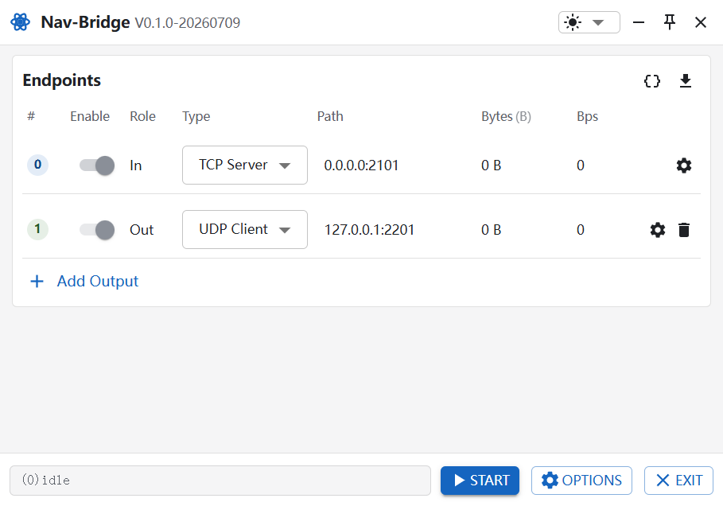
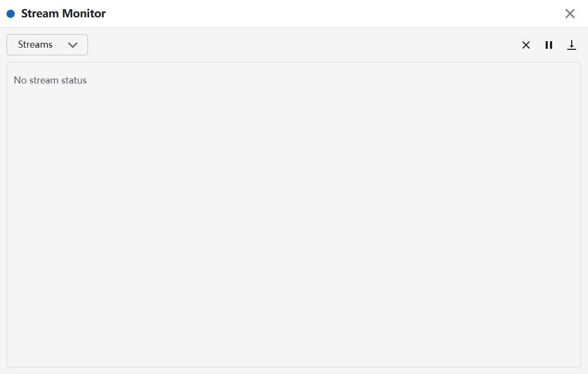

# Nav-Bridge

一个独立的 Electron 桌面应用，用于把外部 GNSS / 导航数据流透明转发给下游工具。

当前版本聚焦 RTKLIB `strsvr` 风格的「1 路输入 → N 路输出」字节转发，为后续接入 Nav-Tools-Lichtblick 和 Foxglove WebSocket 打好基础。

## 功能特性

- **透明转发**：从 1 路输入读取原始字节，写入多路输出。
- **多种传输类型**：支持 TCP Server、TCP Client、UDP Server、UDP Client、Serial 和 File。
- **文件回放**：File 输入 / 输出支持 RTKLIB 风格的 `.tag` 时间戳文件，可按原始采集节奏回放数据。
- **运行监控**：实时展示输入和每路输出的连接状态、累计字节数和实时 bps。
- **桌面 UI**：基于 Electron、React 18 和 MUI 7，支持浅色 / 深色主题。
- **配置持久化**：使用 `electron-store` 保存用户配置，启动后自动恢复。
- **安全边界**：主进程校验配置，启动失败时回滚已打开的流，避免资源泄漏。

## 界面预览

<p align="center">
  
  
</p>

## 环境要求

- Node.js >= 20
- pnpm >= 10
- Windows、Linux 或 macOS

> 串口功能依赖 `serialport` 原生模块。跨平台打包时可能需要重新构建原生依赖。

## 快速开始

```powershell
# 安装依赖
pnpm install

# 启动开发模式
pnpm dev
```

常用命令：

```powershell
pnpm test        # 运行测试
pnpm typecheck   # TypeScript 类型检查
pnpm build       # 构建生产包
pnpm start       # 预览生产包
```

## 使用方式

1. 在主窗口的「Endpoints」区域启用输入和输出端点（点击「Enable」列的开关）。
2. 设置输入流类型和地址。
3. 点击「Add Output」添加至少 1 路输出流，并设置其类型和地址。
4. 点击底部「START」开始转发。
5. 观察状态栏和各端点的实时 Bytes / Bps。
6. 点击主窗口标题栏的监控图标，或底部按钮打开「Stream Monitor」，查看详细日志和 HEX / ASCII 数据。
7. 点击「STOP」关闭当前转发服务。

默认配置：

- 输入：`tcp-server://0.0.0.0:2101`
- 输出：`udp-client://127.0.0.1:2201`

## 项目结构

```text
src/
├── main/                 # Electron 主进程
│   ├── config/           # 配置存储与运行时校验
│   ├── ipc/              # IPC Bridge
│   ├── monitor/          # 监控窗口管理
│   └── stream/           # 转发核心与流适配器
├── preload/              # contextBridge API
├── renderer/             # React + MUI UI
├── shared/               # 主进程 / 渲染进程共享类型与工具
└── test/                 # Jest 测试
```

## 测试

项目使用 Jest 覆盖核心链路：

```powershell
pnpm test
```

当前测试覆盖：

- `StreamServer` 的启动、转发、停止和启动失败回滚。
- TCP Server 输入和 TCP Client 输出。
- UDP Server 输入、UDP Client 输出和绑定失败。
- File 输入 / 输出和 RTKLIB `.tag` 时间戳回放。
- 流方向约束与配置参数校验。
- 字节统计、bps 计算和 UI 组件行为。

## 文档

- [设计方案](./docs/design.md)
- [实现架构](./docs/architecture.md)

## 当前范围与后续计划

**已支持**：

- TCP / UDP / Serial / File 的 1→N 透明转发。
- 运行时状态监控与日志查看。
- 配置持久化。

**不在当前版本**：

- NTRIP Client / Server / Caster
- RTCM / 接收机原始格式转换
- NMEA GGA 请求、周期命令、relay-back
- Foxglove WebSocket 输出适配器

## 国内网络注意事项

项目已配置 `.npmrc`，默认使用 npmmirror 镜像：

- npm 包 registry：`https://registry.npmmirror.com`
- Electron 二进制镜像：`https://npmmirror.com/mirrors/electron/`

如果仍然无法下载 Electron 二进制，可临时设置环境变量后再安装：

```powershell
# PowerShell
$env:ELECTRON_MIRROR="https://npmmirror.com/mirrors/electron/"
pnpm install
```

```sh
# Git Bash / Linux / macOS
export ELECTRON_MIRROR="https://npmmirror.com/mirrors/electron/"
pnpm install
```

## 参考项目

- RTKLIB 2.5.1：`stream.c`、`streamsvr.c`、`str2str.c`
- Nav-Tools-Lichtblick：桌面端结构、React / MUI 技术栈和数据源扩展方向
